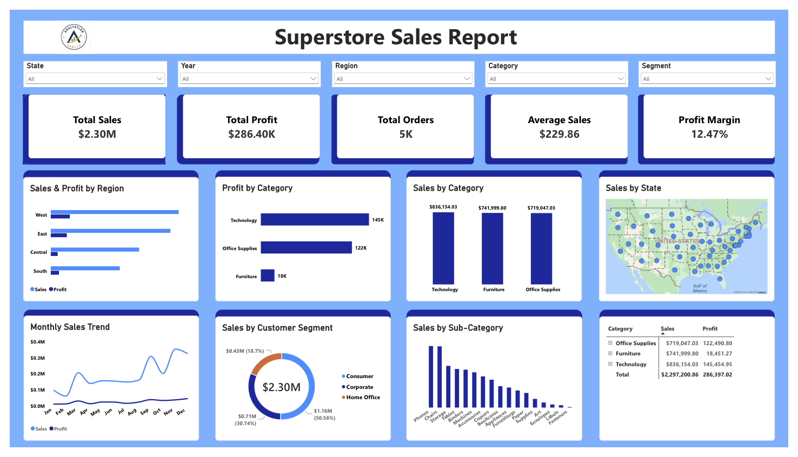
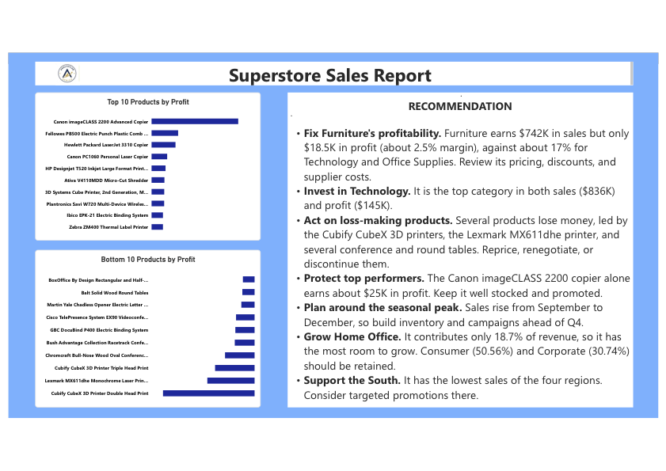

# Superstore Sales Dashboard (Power BI)

An interactive Power BI dashboard analysing Superstore sales performance, built as part of the AnalystLab Africa internship.

## Business Objective
Help management understand overall performance, identify the strongest and weakest regions, segments, categories and products, track trends over time, and decide what actions to take.

## Key Metrics
| Metric | Value |
|---|---|
| Total Sales | $2.30M |
| Total Profit | $286.40K |
| Profit Margin | 12.47% |

## Dashboard Features
- 5 KPI cards: Total Sales, Total Profit, Total Orders, Average Sales, Profit Margin
- Bar charts: Sales & Profit by Region, Profit by Category
- Column charts: Sales by Category, Sales by Sub-Category
- Line chart: Monthly Sales and Profit trend
- Donut chart: Sales by Customer Segment
- Map: Sales by State
- Matrix: Category sales and profit
- Slicers: State, Year, Region, Category, Segment
- Page 2: Top and Bottom 10 products by profit, and recommendations

## Key Insights
- Technology is the top category: $836K sales, $145K profit (17.4% margin).
- Furniture sells well ($742K) but earns only $18K profit (2.5% margin).
- Consumers generate about 51% of revenue.
- Sales peak from September to December.
- Several products, including Cubify CubeX 3D printers, are loss-making.

## Recommendations
1. Review Furniture pricing, discounts and supplier costs.
2. Invest in Technology.
3. Reprice or discontinue loss-making products.
4. Plan inventory and campaigns around the Q4 peak.
5. Grow the Home Office segment and the South region.

## Files
- `Superstore_Sales.pbix`: Power BI project file
- `Superstore_Sales.pdf`: dashboard export
- `BI_Overview_Report`: Business Intelligence overview
- `Executive_Summary_Report`: executive summary

## Tools
Power BI Desktop, DAX

## How to Open
Download the `.pbix` file and open it in Power BI Desktop.

## Author
Gideon Adebayo | LinkedIn: www.linkedin.com/in/gideon-adebayo-
